  

<h1 align="center">danvric</h1>

  <strong>Engineering · Computing · Global Technology</strong> 
  Building, learning, documenting, and sharing in the open.

  
  
  

## About

I am an undergraduate student exploring the intersection of **engineering, computer science, and open knowledge**. I learn by building small tools, studying technical systems, documenting what I discover, and sharing useful information.

My interests include nuclear engineering, AI and computer science, scientific computing, automation and web data collection, global education opportunities, technology and markets, and open-source collaboration.

> **A simple principle:** reduce information gaps by making useful knowledge and tools easier to find, understand, and improve.

## Selected Projects

| Project | What it is |
|---|---|
| [Mataroa × GitHub Bridge](https://github.com/danvric/mataroa-github-bridge-for-fork) | A Python-standard-library and GitHub Actions workflow for backing up Mataroa posts to Markdown, managing drafts in GitHub, and publishing them back to Mataroa. |
| [DRAGON5 Reactor Notes (中文)](https://github.com/danvric/dragon-reactor-notes-cn) | Community-oriented Chinese learning notes that restructure DRAGON5 / IGE335 reactor-lattice documentation into clearer explanations, examples, and practical notes. Unofficial learning material. |
| [MIT 6.0001 — Self-study](https://github.com/danvric/MIT-6.0001) | My solutions and learning notes while independently studying MIT OpenCourseWare's Introduction to Computer Science and Programming in Python. |
| [NCWU Info — For Surviving Better](https://github.com/danvric/NCWU-info-For-Surviving-Better) | A student-maintained, non-official guide collecting practical campus information to help students find reliable answers and avoid information gaps. |
| [Small Programs](https://github.com/danvric/smallprogram) | A growing collection of small utilities, algorithm experiments, and practical programming projects. |

## Areas I Explore

- **Engineering & science** — nuclear engineering, reactor physics tools, and scientific computing.
- **Computing & AI** — computer science fundamentals, Python, automation, and practical AI-assisted workflows.
- **Data & information tools** — web scraping, information collection, and turning scattered information into usable resources.
- **Global opportunities** — international education and exchange programmes, cross-border knowledge, and access to information.
- **Open-source mindset** — build, iterate, document, and share useful work publicly.
- **Technology & markets** — following how technology, innovation, and capital shape the global economy.

## Tools & Technologies

  

## GitHub Activity & Rank

  
  

The rank shown on the statistics card is calculated by a third-party model from **public GitHub activity** (such as commits, pull requests, reviews, issues, stars, and followers). It is not a GitHub certification, a programming test, or a measure of professional ability. The language card reflects code distribution in public repositories, not proficiency.

## GitHub Achievements

GitHub's native achievement badges are displayed on the profile itself when they are earned. I rely on GitHub's own achievement system rather than presenting third-party trophies as official awards.

[Visit my GitHub profile →](https://github.com/danvric)

## Support My Work

If any of these projects are useful, the most meaningful support is to:

- ⭐ Star a repository you find useful.
- 🐛 Report an issue, outdated information, or a bug.
- 🔧 Contribute a correction, example, translation, or pull request.
- 🌍 Share useful projects and information with people who may need them.

  

Financial sponsorship links will be added once I have a verified payout option available for my place of residence. I will not link to an inactive or unusable payment page.

---

## Contribution Snake

  <picture>
    <source media="(prefers-color-scheme: dark)" srcset="https://raw.githubusercontent.com/danvric/danvric/output/github-snake-dark.svg" />
    <source media="(prefers-color-scheme: light)" srcset="https://raw.githubusercontent.com/danvric/danvric/output/github-snake.svg" />
    
  </picture>

